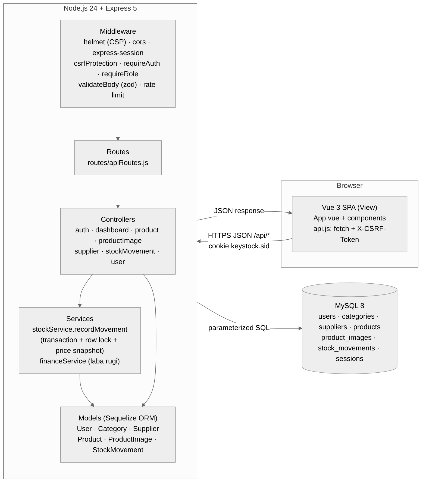
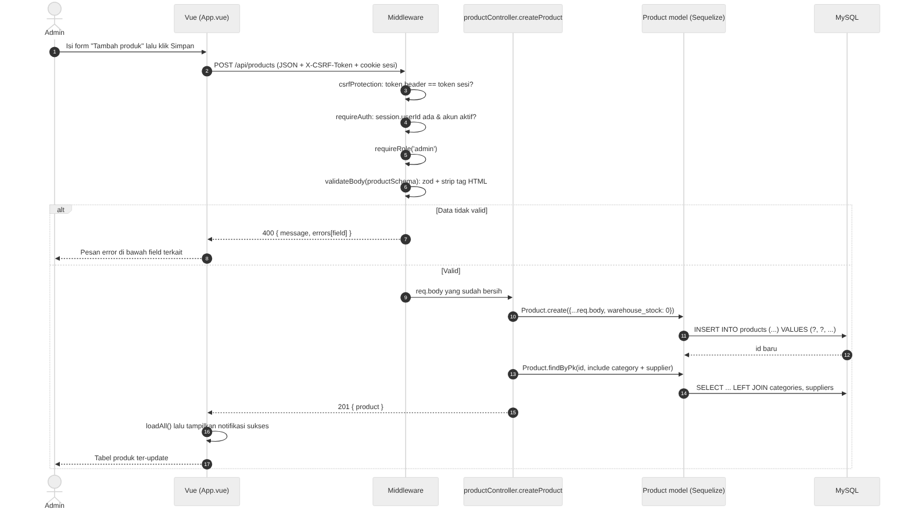
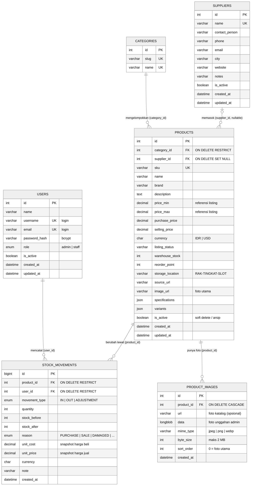
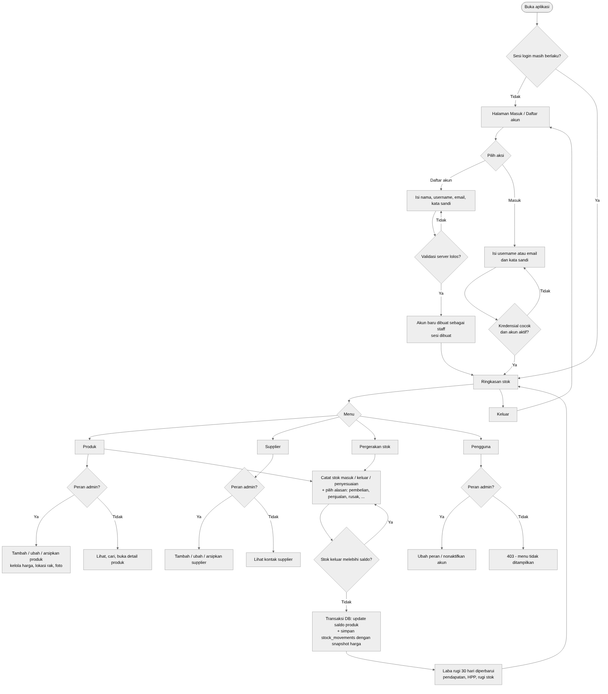

# Kebutuhan dan Arsitektur — KeyStock

## Studi kasus

KeyStock adalah sistem **manajemen inventaris gudang** untuk keyboard mechanical dan aksesori (studi kasus pilihan UAS: *Sistem Manajemen Inventaris Gudang*). Pemilik/admin mengelola katalog, supplier, dan pengguna; staff gudang mencatat setiap stok masuk, stok keluar, dan penyesuaian. Status listing marketplace hanya referensi — aplikasi tidak memanggil API marketplace.

Katalog contoh berisi 23 produk (keyboard, switch, keycaps, deskmat, aksesori). Jumlah stok, lokasi rak, harga beli/jual, dan riwayat 7 hari terakhir adalah **data simulasi** dari seeder (harga beli dihitung dari rasio modal per kategori, harga jual = harga katalog).

### Akun uji

| Peran | Username | Email | Kata sandi |
| --- | --- | --- | --- |
| Admin (untuk dosen penguji) | `dosen` | `dosen@keystock.local` | `12345678` |
| Staff | `staff` | `staff@keystock.local` | `12345678` |

Akun dibuat oleh `npm run db:seed` dari variabel `SEED_DOSEN_*` dan `SEED_STAFF_*` di `.env` (tidak ditulis di kode). Login menerima **username atau email**.

> **Stack:** Soal UAS menyebut Laravel + Eloquent. Proyek ini memakai **Vue 3 + Node.js/Express + MySQL + Sequelize ORM** atas persetujuan dosen. Pola MVC, relasi ORM, validasi server, CSRF, session, dan RBAC tetap diterapkan; padanan Eloquent dijelaskan di tabel bawah.

## Hak akses pengguna

| Aksi | Admin | Staff |
| --- | :---: | :---: |
| Daftar akun sendiri (otomatis menjadi staff) | – | ✓ |
| Login, logout, melihat ringkasan / laba rugi / produk / supplier / riwayat stok | ✓ | ✓ |
| Mencatat stok masuk, stok keluar, penyesuaian (beserta alasannya) | ✓ | ✓ |
| Tambah, ubah, arsipkan produk (harga, lokasi rak) | ✓ | ✗ (403) |
| Unggah, urutkan, hapus foto produk | ✓ | ✗ (403) |
| Tambah, ubah, arsipkan supplier | ✓ | ✗ (403) |
| Lihat pengguna, ubah peran, nonaktifkan akun | ✓ | ✗ (403) |

Aturan di atas ditegakkan di server oleh middleware `requireAuth` dan `requireRole('admin')` (`server/src/middleware/auth.js`). Menu yang disembunyikan di tampilan hanya kenyamanan, bukan pengaman.

## Fitur

1. Registrasi (nama, username, email; otomatis staff), login dengan username **atau** email, logout, session server-side di MySQL.
2. Ringkasan stok: KPI total unit (perubahan 7 hari), jumlah perlu restock, stok habis; heatmap aktivitas 7/14/30 hari; stok terendah/rata-rata/tertinggi; kartu detail produk; tabel aktivitas terbaru dengan filter dan pagination; ekspor CSV (termasuk laba per unit, margin, nilai stok).
3. **Laba & rugi 30 hari**: pendapatan, HPP (modal barang terjual), laba kotor, margin, rugi stok (rusak/hilang), laba bersih, belanja stok, unit terjual, nilai stok (modal), dan potensi laba stok. Dihitung dari *snapshot* harga di setiap pergerakan, jadi perubahan harga tidak mengubah laporan lama.
4. **Peta rak gudang**: tampilan depan rak bertingkat; lokasi memakai format `RAK-TINGKAT-SLOT` (mis. `A-1-05`), satu slot hanya untuk satu produk aktif; tinggi kardus mengikuti jumlah stok, warna mengikuti status stok; klik kardus membuka detail produk.
5. CRUD produk (tambah, lihat + cari + filter, ubah, arsip/soft delete) dengan validasi server per-field; harga beli/jual dengan laba per unit dan margin.
6. **Detail produk** (dialog): galeri foto dengan slide, harga & laba, statistik 30 hari, riwayat terakhir, dan kontak supplier. Admin dapat mengunggah (JPEG/PNG/WebP, maks 2 MB, maks 8 foto), mengurutkan, menjadikan foto utama, dan menghapus foto.
7. CRUD supplier (tambah, lihat, ubah, arsip); tombol **WhatsApp** (`wa.me`, nomor 08… otomatis menjadi 628…), telepon, dan email.
8. Pergerakan stok: masuk (pembelian, retur pelanggan), keluar (penjualan, rusak, hilang, retur ke supplier), penyesuaian (stock opname). Setiap catatan menyimpan stok sebelum/sesudah, alasan, harga saat itu, pengguna, waktu, dan catatan; pratinjau saldo dan nilai rupiah sebelum disimpan; riwayat dengan pencarian dan filter.
9. Manajemen pengguna (admin): ubah peran admin/staff, nonaktifkan/aktifkan akun; tabel rincian hak akses.
10. Mode terang/gelap, layout responsif (tab bar bawah di ponsel, tabel menjadi kartu).

## Arsitektur (MVC)

| Lapisan MVC | Lokasi | Isi |
| --- | --- | --- |
| **Model** | `server/src/models/index.js` | Definisi tabel + relasi Sequelize (`hasMany` / `belongsTo`) |
| **View** | `client/src/App.vue`, `client/src/components/*` | Antarmuka Vue; render data JSON, escape otomatis |
| **Controller** | `server/src/controllers/*.js` | Menerima request, memanggil model/service, mengembalikan JSON |
| Routes | `server/src/routes/apiRoutes.js` | Memetakan URL + method ke controller dan middleware |
| Middleware | `server/src/middleware/*.js` | CSRF, autentikasi, otorisasi peran, validasi, error handler |
| Service | `server/src/services/stockService.js`, `financeService.js` | Logika stok dalam transaksi database + row lock; ringkasan laba rugi |

### Siklus request (contoh: tambah produk)

### Routing API

| Method | Endpoint | Middleware | Controller |
| --- | --- | --- | --- |
| GET | `/api/health` | – | health check |
| GET | `/api/auth/csrf` | – | `getCsrfToken` |
| GET | `/api/auth/me` | – | `getCurrentUser` |
| POST | `/api/auth/register` | csrf, rate limit, `registerSchema` | `register` |
| POST | `/api/auth/login` | csrf, rate limit, `loginSchema` | `login` |
| POST | `/api/auth/logout` | csrf, `requireAuth` | `logout` |
| GET | `/api/dashboard` | `requireAuth` | `getDashboard` |
| GET | `/api/categories` | `requireAuth` | `listCategories` |
| GET | `/api/products` | `requireAuth` | `listProducts` (search, kategori, stok rendah) |
| GET | `/api/products/:id` | `requireAuth` | `getProduct` (foto, riwayat, statistik 30 hari) |
| GET | `/api/products/:id/images` | `requireAuth` | `listImages` |
| GET | `/api/products/:id/images/:imageId/file` | `requireAuth` | `sendImageFile` |
| POST | `/api/products/:id/images` | csrf, `requireAuth`, `requireRole('admin')`, body mentah ≤ 2 MB | `uploadImage` |
| PUT | `/api/products/:id/images/order` | csrf, `requireAuth`, `requireRole('admin')`, `imageOrderSchema` | `reorderImages` |
| DELETE | `/api/products/:id/images/:imageId` | csrf, `requireAuth`, `requireRole('admin')` | `deleteImage` |
| POST | `/api/products` | csrf, `requireAuth`, `requireRole('admin')`, `productSchema` | `createProduct` |
| PUT | `/api/products/:id` | csrf, `requireAuth`, `requireRole('admin')`, `productSchema` | `updateProduct` |
| DELETE | `/api/products/:id` | csrf, `requireAuth`, `requireRole('admin')` | `deleteProduct` (arsip) |
| GET | `/api/suppliers` | `requireAuth` | `listSuppliers` |
| POST / PUT / DELETE | `/api/suppliers[/:id]` | csrf, `requireAuth`, `requireRole('admin')`, `supplierSchema` | create / update / archive |
| GET | `/api/stock-movements` | `requireAuth` | `listMovements` |
| POST | `/api/stock-movements` | csrf, `requireAuth`, `movementSchema` | `createMovement` |
| GET | `/api/users` | `requireAuth`, `requireRole('admin')` | `listUsers` |
| PATCH | `/api/users/:id` | csrf, `requireAuth`, `requireRole('admin')`, `userUpdateSchema` | `updateUser` |

## Database

Enam tabel domain + tabel `sessions` (dibuat otomatis oleh `express-mysql-session`):

- `categories` 1–N `products` (FK `category_id`, `ON DELETE RESTRICT`)
- `products` 1–N `product_images` (FK `product_id`, `ON DELETE CASCADE`)
- `suppliers` 0..1–N `products` (FK `supplier_id`, nullable, `ON DELETE SET NULL`)
- `products` 1–N `stock_movements` (FK `product_id`, `ON DELETE RESTRICT`)
- `users` 1–N `stock_movements` (FK `user_id`, `ON DELETE RESTRICT`)

Skrip SQL: [`database/schema.sql`](../database/schema.sql) (struktur) dan [`database/keystock-demo.sql`](../database/keystock-demo.sql) (struktur + data demo). Migrasi kode: `npm run db:sync` (`sequelize.sync` + `server/src/db/migrations.js`, yang juga menambah kolom baru ke database lama).

### Padanan Sequelize ↔ Eloquent

| Kebutuhan | Sequelize (proyek ini) | Eloquent (Laravel) |
| --- | --- | --- |
| Relasi 1–N | `Category.hasMany(Product)` / `Product.belongsTo(Category)` | `hasMany()` / `belongsTo()` |
| Eager loading | `findAll({ include: [{ model: Category, as: 'category' }] })` | `Product::with('category')->get()` |
| Eager loading bertingkat | `include: [{ model: Product, include: [Category] }]` | `with('product.category')` |
| Hitung relasi | `fn('COUNT', col('movements.id'))` + `group` | `withCount('movements')` |
| Transaksi + lock | `sequelize.transaction()` + `lock: transaction.LOCK.UPDATE` | `DB::transaction()` + `lockForUpdate()` |
| Query aman | binding parameter otomatis (`?`) | binding parameter PDO |

## Keamanan

| Ancaman | Mitigasi | Lokasi |
| --- | --- | --- |
| SQL Injection | Semua query lewat Sequelize dengan parameter binding; tidak ada string SQL dari input | `models`, `controllers` |
| XSS | Vue `{{ }}` meng-escape output, tidak ada `v-html`; server membuang tag HTML (`stripTags`); URL hanya `http(s)` (menolak `javascript:`); header CSP via Helmet | `middleware/validators.js`, `app.js` |
| CSRF | Token acak 32 byte per sesi, wajib di header `X-CSRF-Token` untuk POST/PUT/PATCH/DELETE, dibandingkan `timingSafeEqual`; cookie `SameSite=Lax` | `middleware/csrf.js` |
| Pencurian sesi | Cookie `HttpOnly`, `Secure` di production, sesi disimpan di MySQL, `session.regenerate()` saat login/registrasi | `app.js`, `authController.js` |
| Brute force | Rate limit login 8×/15 menit, registrasi 10×/jam per IP | `routes/apiRoutes.js` |
| Password bocor | bcrypt cost 12; hash tidak pernah dikirim (default scope menyembunyikan `password_hash`) | `models/index.js` |
| Akses tanpa hak | `requireAuth` + `requireRole('admin')`; akun nonaktif langsung ditolak | `middleware/auth.js` |
| Data stok tidak konsisten | Transaksi + row lock; stok keluar tidak boleh melebihi saldo | `services/stockService.js` |
| CSV injection | Sel ekspor yang diawali `= + - @` diberi prefix `'` | `App.vue` (`exportInventoryCsv`) |
| Upload file berbahaya | Hanya admin; tipe dicek dari *magic bytes* (JPEG/PNG/WebP), bukan nama file; maks 2 MB dan 8 foto per produk; disajikan dengan `Content-Type` asli + `nosniff` | `controllers/productImageController.js` |
| Slot rak bentrok | Format `RAK-TINGKAT-SLOT` divalidasi; slot yang sudah dipakai produk aktif ditolak (409) | `validators.js`, `productController.js` |

## Alur aplikasi

